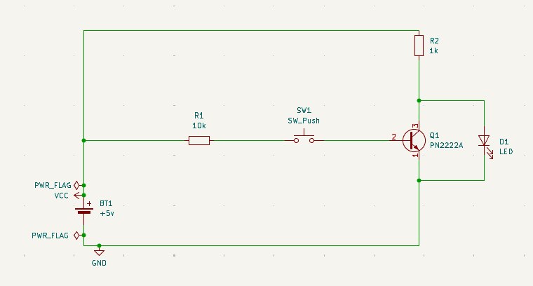
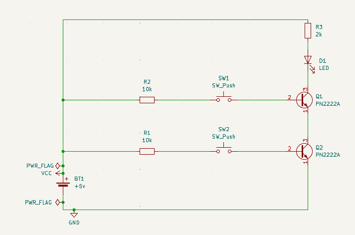
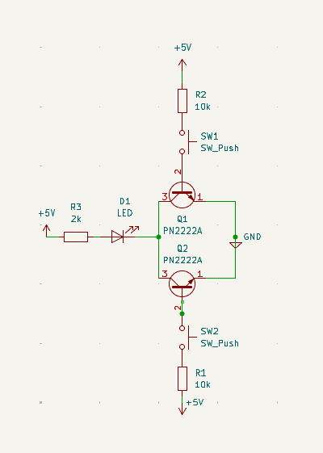
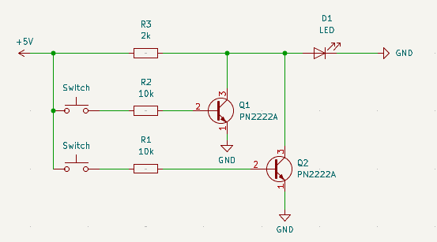
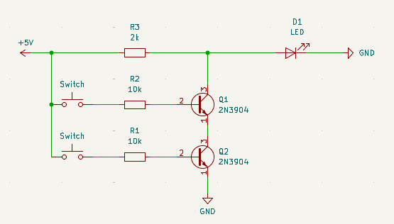
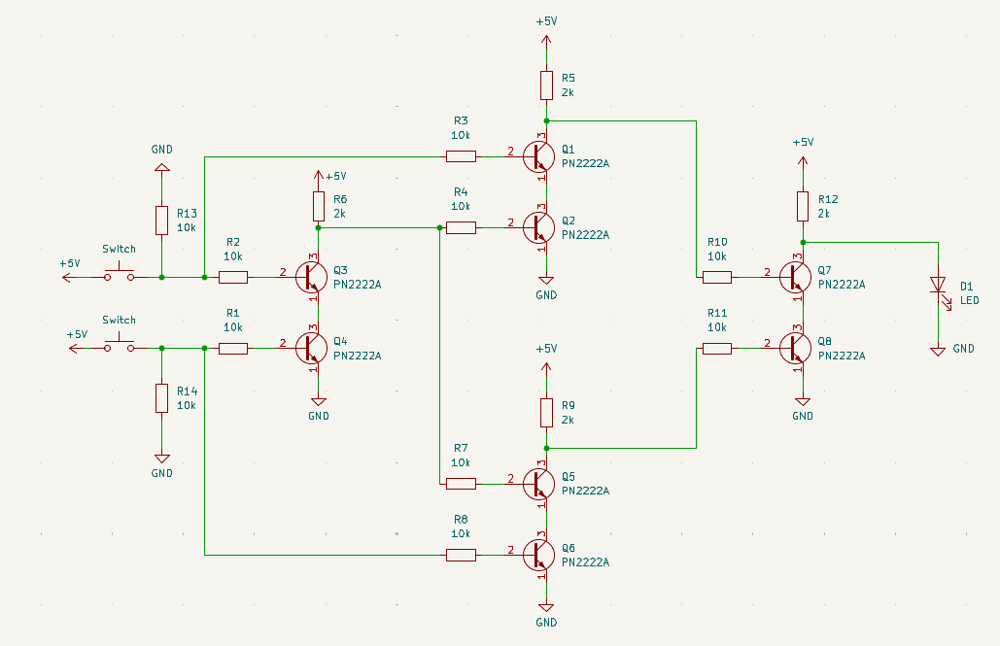

<header class="header">
  <a href="./post3.html" class="home-link">← back</a>
</header>

> _The invention of the transistor may be the most important invention of the 20th century._ - Gordon Moore

Starting from this section of my notepad on building a computer I can align each section with the Nand to Tetris Course. Actually I am using the book _The Elements of Computing Systems_ by the same professors. 

**Progress:** Completed Project 1 from the book. All material updated on my github [here](https://github.com/deepak-venkatesh/nand-to-tetris)

Some of the combinational logic gates I have built are documented below. Combinational logic gates mean that the output is dependent on a combination of the inputs. The output is free from time or any sequences as such.

These gates are the building blocks for the next set of circuits which we will make. Here we are using BJTs like we mentioned in the previous part of this project and within the next few circuits we will move to ICs or Integrated Circuits. ICs essentially are an extremely compact version of these BJT based circuits. 

If you are reading this and trying to build your own computer now is the time to start researching on what components you need to buy. All my circuits have the exact parts labelled. All of this is put on to breadboards. Videos or photos show the exact mechanism. Hope this will help.

## NOT Logic Gate
Also called the inverter simply converts a 0 to 1 and a 1 to 0. 

| IN | NOT |
|----|-----|
| 0  | 1   |
| 1  | 0   |

{.responsive-img}

 <small>1 Bit NOT Logic Gate Circuit</small> 

  <iframe
    src="https://www.youtube.com/embed/HKwXmZ-kiXQ"
    title="NOT Gate"
    allow="accelerometer; autoplay; clipboard-write; encrypted-media; gyroscope; picture-in-picture; web-share"
    allowfullscreen>
  </iframe>

## AND Logic Gate
The truth table is below.

| A | B | AND |
|---|---|-----|
| 0 | 0 | 0   |
| 0 | 1 | 0   |
| 1 | 0 | 0   |
| 1 | 1 | 1   |

{.responsive-img}

 <small>1 Bit AND Logic Gate Circuit</small> 

  <iframe
    src="https://www.youtube.com/embed/GGVlgF7a0zY"
    title="AND Gate"
    allow="accelerometer; autoplay; clipboard-write; encrypted-media; gyroscope; picture-in-picture; web-share"
    allowfullscreen>
  </iframe>

## OR Logic Gate
The truth table is below.

| A | B | OR |
|---|---|----|
| 0 | 0 | 0  |
| 0 | 1 | 1  |
| 1 | 0 | 1  |
| 1 | 1 | 1  |

{.responsive-img}

 <small>1 Bit OR Logic Gate Circuit</small> 

  <iframe
    src="https://www.youtube.com/embed/ViSYYkTSXuE"
    title="OR Gate"
    allow="accelerometer; autoplay; clipboard-write; encrypted-media; gyroscope; picture-in-picture; web-share"
    allowfullscreen>
  </iframe>

## NOR Logic Gate
The truth table is below.

| A | B | NOR |
|---|---|-----|
| 0 | 0 | 1   |
| 0 | 1 | 0   |
| 1 | 0 | 0   |
| 1 | 1 | 0   |

{.responsive-img}

 <small>1 Bit NOR Logic Gate Circuit</small> 

  <iframe
    src="https://www.youtube.com/embed/BWPggF5wnLQ"
    title="NOR Gate"
    allow="accelerometer; autoplay; clipboard-write; encrypted-media; gyroscope; picture-in-picture; web-share"
    allowfullscreen>
  </iframe>

## NAND Logic Gate
The truth table is below.

| A | B | NAND |
|---|---|------|
| 0 | 0 | 1    |
| 0 | 1 | 1    |
| 1 | 0 | 1    |
| 1 | 1 | 0    |

{.responsive-img}

 <small>1 Bit NAND Logic Gate Circuit</small> 

  <iframe
    src="https://www.youtube.com/embed/wSkmmx20C0M"
    title="NAND Gate"
    allow="accelerometer; autoplay; clipboard-write; encrypted-media; gyroscope; picture-in-picture; web-share"
    allowfullscreen>
  </iframe>

## XOR Logic Gate
The truth table is below. I used NAND gates to build the XOR gate.

| A | B | XOR |
|---|---|-----|
| 0 | 0 | 0   |
| 0 | 1 | 1   |
| 1 | 0 | 1   |
| 1 | 1 | 0   |

{.responsive-img}

 <small>1 Bit XOR Logic Gate Circuit</small> 

  <iframe
    src="https://www.youtube.com/embed/go_RwYugdTc"
    title="XOR Gate"
    allow="accelerometer; autoplay; clipboard-write; encrypted-media; gyroscope; picture-in-picture; web-share"
    allowfullscreen>
  </iframe>

**Endnote**: These were simply 1 bit combinational logic gates. Now onto half adders and full adders and then perhaps build a 4 bit, 8 bit or even a 16 bit full adder followed by an ALU (Arithmetic Logic Unit).

_Last Updated: 17 Oct 2026_

<footer class="footer">
  <a href="./post3.html" class="home-link">← back</a>
</footer>
