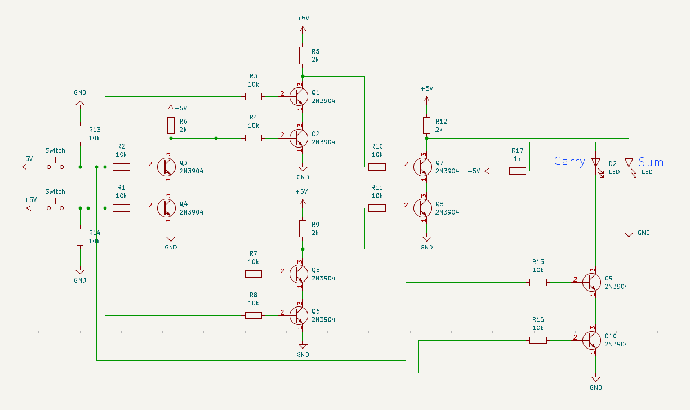

<header class="header">
  <a href="./post3.html" class="home-link">← back</a>
</header>

> _The unity expresses God; the zero nothing; and every number is composed of the unity and the zero._ - Gottfried Leibniz

**Progress:** Completed Project 2 from the book. All material updated on my github [here](https://github.com/deepak-venkatesh/nand-to-tetris). Although the chapter includes Arithmetic Logic Unit in the hardware simulator. I will need to implement that in physical circuits.

## Half Adder
This was fun. Since my kids participated to build this. The video is narrated by my 3rd grader daughter and the sum and carry LED glows is called out by my toddler son.
I am still using transistors in this and as you can see the number of transistors is 10 now. I will probably switch to ICs for my full adder.

A half adder adds two bits. A bit is like we mentioned before a 0 or 1 (in the world of binary).

| A | B | CARRY | SUM |
|---|---|-------|-----|
| 0 | 0 | 0     | 0   |
| 0 | 1 | 0     | 1   |
| 1 | 0 | 0     | 1   |
| 1 | 1 | 1     | 0   |

{.responsive-img}

 <small>Half Adder</small> 

  <iframe
    src="https://www.youtube.com/embed/MjyxJtvg9s0"
    title="Half Adder"
    allow="accelerometer; autoplay; clipboard-write; encrypted-media; gyroscope; picture-in-picture; web-share"
    allowfullscreen>
  </iframe>

_Last Updated: 19 Oct 2026_

<footer class="footer">
  <a href="./post3.html" class="home-link">← back</a>
</footer>
